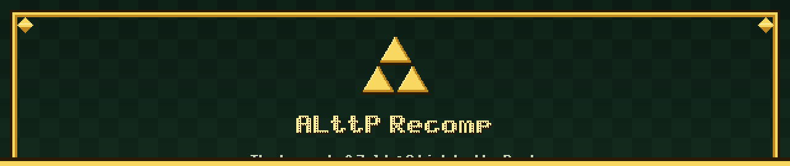
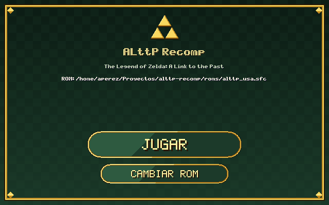
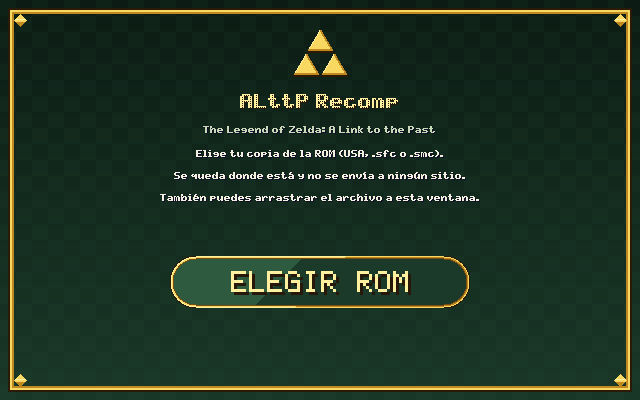
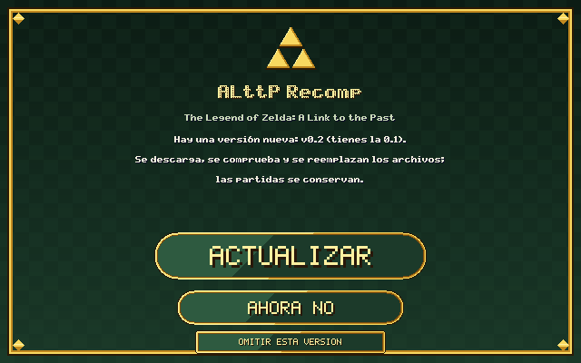
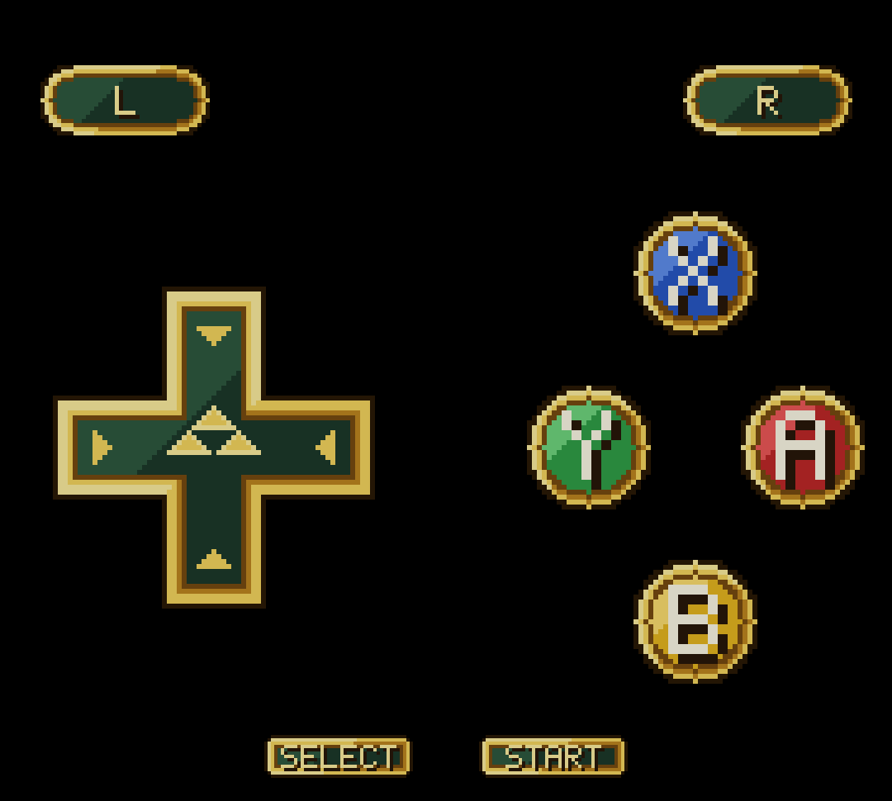

  

<h3 align="center">The Legend of Zelda: A Link to the Past, recompilado a código nativo</h3>

  
  
  
  

No es un emulador: el programa de la cartucho se **traduce a código nativo** (con el motor [`snes-recomp`](https://github.com/AlexPerez7/snes-recomp)) y se compila en tu equipo a partir de **tu** copia del juego. El resultado arranca al instante, mantiene los 60 fotogramas por segundo incluso en un móvil de gama alta y permite mejoras que un emulador no da: pantalla ancha, español, estados guardados y rebobinado, y un puñado de ajustes de calidad de vida.

> **Aviso legal.** Este repositorio no contiene la ROM ni ningún recurso del juego (gráficos, sonido, texto, mapas), y no lo tendrá. Cada persona debe aportar su propia copia obtenida legalmente (USA, CRC32 `777AAC2F`). Nada derivado de ella se distribuye ni sale de tu equipo. Proyecto independiente y sin relación con Nintendo.

## Descargar y jugar

Descarga el paquete de tu sistema de la [última release](https://github.com/AlexPerez7/alttp-recomp/releases/latest). **No hay que instalar nada ni usar la terminal.**

| | Windows | Linux | Android |
|---|---|---|---|
| **Fichero** | `alttp-recomp-…-win64.zip` | `alttp-recomp-…-linux-x86_64.tar.gz` | `ALttP-Recomp-….apk` |
| **1.** | Descomprime | Extrae | Descarga e instala (permite la fuente) |
| **2.** | Abre `snes-port.exe` | Abre `alttp-recomp` | Abre la app |
| **3.** | **Elegir ROM** y **Jugar** | **Elegir ROM** y **Jugar** | Elige tu ROM y juega |
| **Requisitos** | Windows 10 o 11 | x86_64, glibc 2.38+ (Ubuntu 24.04, Debian 13…) | Android 10+ (arm64) |

  
  
  

El lanzador de Windows y Linux: elige tu ROM una vez y después solo pulsas <b>Jugar</b>. A la derecha, el aviso opcional de versión nueva.

La ROM se queda donde está: solo se recuerda su ruta, y en Android se copia a la carpeta privada de la app. La primera vez el juego se prepara en tu equipo (en Linux y Android, unos segundos); si algo falla, la ventana lo cuenta.

> Es normal que algún antivirus desconfíe de un programa sin firmar que compila código al arrancar. Todo ocurre en tu máquina.

## Características

- **Recompilación, no emulación.** Las 4 178 funciones de la ROM se traducen a C y se compilan; sin capa de emulación.
- **Pantalla ancha** sin basura: con `wide` el borde del mapa y el interior de salas y cuevas se tapan en negro en vez de repetir el otro lado del mapa.
- **Español completo.** Mensajes, selección de partida, registro de nombre y acciones del menú de pausa, con acentos, `ñ`, `¿` y `¡` dibujados al vuelo con la propia fuente del juego. [Cómo funciona →](docs/TRADUCCION.md)
- **Estados guardados y rebobinado.** **F5** guarda, **F7** carga, **F3**/**F4** cambian de ranura (hasta 9) y mantener **Retroceso** rebobina unos 10 segundos.
- **Mensajes más rápidos.** Mantén **R** (o `W` en el teclado) y el texto sale un carácter por fotograma.
- **Mejoras de calidad de vida opcionales** (saltar la intro con una tecla, cambio de objeto con L/R, espada que recoge objetos y rompe vasijas, hasta 9999 rupias…): [lista completa](#mejoras-de-calidad-de-vida).
- **Android de verdad.** Controles táctiles con el arte del juego (cruceta con Trifuerza, botones A/B/X/Y de gema), disposición para vertical y horizontal.
- **Actualizaciones en un clic** (Windows y Linux), **apagadas por defecto**: si las activas, el lanzador avisa de una versión nueva y la instala comprobando su SHA-256. [Detalles →](#actualizaciones)
- **Privacidad.** Sin telemetría. La única conexión posible es la comprobación de versión, que tú activas.

  

Controles táctiles de la versión Android (arte propio).

## ¿Por qué no usar un emulador?

Un emulador es la mejor opción para jugar *cualquier* juego de SNES con la máxima fidelidad. Este proyecto hace otra cosa: convierte **este** juego en un programa nativo, y eso permite lo que un emulador no puede dar con la ROM original.

| | Emulador | ALttP Recomp |
|---|---|---|
| **Mejoras de jugabilidad** (cambio de objeto con L/R, espada que recoge objetos y rompe vasijas, más bombas, 9999 rupias…) | Exigen un hack de la ROM o un parche IPS | Se activan desde el menú sobre tu ROM sin tocar, y cada una tiene prueba automática |
| **Español** | Parche aplicado a la ROM | Se sustituye en tiempo real, con acentos y `ñ` dibujados con la propia fuente del juego; el fichero se relee mientras juegas |
| **Pantalla ancha** | Casi siempre no, o con trucos por juego | Columnas extra reales, tapadas en negro donde no hay mapa |
| **Android** | Instalar un emulador y configurarlo | Un APK con controles táctiles hechos para el juego |
| **Extensible** | Hay que hacer ingeniería inversa y parchear | Se añade una mejora escribiendo C sobre el código ya traducido |
| **Fidelidad al hardware** | Muy alta (bsnes, por ejemplo) | Menor: la PPU no emula el entrelazado, lo que depende de ciclos exactos no se reproduce y el DSP no usa la tabla exacta |
| **Juegos** | Todos los de SNES | Solo este (USA, CRC32 `777AAC2F`) |

Lo que sí tiene este proyecto y también tienen los emuladores: estados guardados y rebobinado, filtros y scanlines, y reasignación de teclas y mandos desde el menú **F1**.

## Hoja de ruta

Cosas que los emuladores dan y este proyecto aún no. No están prometidas ni tienen fecha: son la dirección.

- **Shader de CRT** (máscara de fósforo, haz de scanline, curvatura y resplandor): en curso en el motor.
- **Más ajustes de imagen y mando**, con la comodidad de un emulador maduro.
- **Logros** (RetroAchievements) para el juego.
- **Juego en red** (netplay) o partida compartida.
- **Arreglos de bugs del juego original**, como opciones que se activan una a una (cada dirección se comprueba contra la ROM) y más mejoras de calidad de vida en C, a medida que se prueben.
- **Pruebas en Windows** de la actualización automática y de la reconstrucción del `.exe` del motor.

## Mejoras de calidad de vida

Son opciones del juego: se activan en la pestaña **Game** del menú **F1** o con `--game-opt nombre=valor`. Las marcadas con ✔ están activas por defecto; el resto, apagadas.

| | Opción | Qué hace |
|---|---|---|
| ✔ | `dialog_skip` | Mantén **R** durante un mensaje y sale un carácter por fotograma. |
| | `language=es` | El juego en español (mensajes, selección de partida, menús). |
| | `wide=N` | Pantalla ancha con las columnas extra tapadas en negro donde no hay mapa. |
| | `item_switch_lr=1` | **L**/**R** (`Q`/`W`) eligen el objeto anterior o siguiente y lo ponen en Y sin abrir el menú. |
| | `dash_turn=1` | Cambiar de dirección durante la carrera con las botas gira a Link en lugar de cortar la carrera. |
| | `bird_cancel=1` | En el mapa del pájaro, **B** cancela el viaje y te deja donde estabas. |
| | `sword_pickup=1` | El espadazo recoge los objetos del suelo que alcanza (rupias, corazones, magia, bombas, flechas, llaves). |
| | `sword_pots=1` | En mazmorras, la espada rompe las vasijas como el martillo. |
| | `more_bombs=1` | Cuatro bombas puestas a la vez en vez de dos (cada una sigue gastando una). |
| | `rupees_9999=1` | La cartera guarda hasta 9999 rupias, con marcador de cuatro dígitos. |
| | `rupee_fast=1` | El marcador de rupias alcanza la cartera en un par de segundos (en vez de una rupia por fotograma: 500 rupias tardan 8 s), subiendo y bajando. |
| | `max_yellow=1` | Rupias, bombas y flechas en su tope se dibujan en amarillo. |
| | `skip_intro=1` | **Start** o **A** durante la intro (el logo, la historia y el Triforce) saltan a la selección de partida. |
| | `fix_portal_chime=1` | Arreglo de un bug del original: levantar la roca que tapa el portal mágico del Templo de Hielo no hacía el sonido de descubrimiento. |
| | `fix_death_count=1` | Arreglo de un bug del original: elegir «Continuar» sin guardar en la pantalla de fin de partida contaba la muerte igualmente. |
| | `fix_medallion_abort=1` | Arreglo de un bug del original: Bombos, Ether y Quake no se cancelan si sueltas el espadazo cargado en el mismo fotograma en que los usas. |
| | `fix_magic_refund=1` | Arreglo de un bug del original: la devolución de magia (cuando falla un efecto) no pasa de 128. |
| | `fix_somaria_nomagic=1` | Arreglo de un bug del original: usar el bastón de Somaria sin magia y cambiar enseguida a la seta o el polvo ya no esparce polvo sin pulsar nada. |
| | `fix_moldorm_sound=1` | Arreglo de un bug del original: el golpe del Moldorm gigante a Link suena (el original pierde el sonido al calcular el pan). |
| | `fix_swamola_bank=1` | Arreglo de un bug del original: los Lanmolas (Swamola) de Misery Mire leen su tabla con el banco de datos equivocado y sus segmentos salen mal. |
| | `fix_kiki_bomb=1` | Arreglo de un bug del original: la bomba que Kiki llevaba no queda armada al empezar a seguirte. |
| | `fix_bunny_palette=1` | Arreglo de un bug del original: morir de conejo restaura la paleta de Link durante la animación de muerte. |
| | `fix_spell_lock=1` | Arreglo de un bug del original: tras lanzar un medallón y morir, el menú de guardar ya no se queda bloqueado. |
| | `fix_ledge_platform=1` | Arreglo de un bug del original: salir mientras saltas una cornisa y recibir un golpe en una plataforma ya no te deja pasar bajo capas sólidas. |
| | `fix_shield_palette=1` | Arreglo de un bug del original: el escudo que suelta un Pikit carga su paleta (Link no se queda con los colores del anterior). |
| | `low_hp_beep=0` | Quita el pitido de poca vida. |

Las mejoras que tocan el juego (`skip_intro`, `fix_portal_chime`, `fix_death_count`, `fix_medallion_abort`, `fix_magic_refund`, `fix_somaria_nomagic`, `fix_moldorm_sound`, `fix_swamola_bank`, `fix_kiki_bomb`, `fix_bunny_palette`, `fix_spell_lock`, `fix_ledge_platform`, `fix_shield_palette`, `item_switch_lr`, `dash_turn`, `bird_cancel`, `sword_pickup`, `sword_pots`, `more_bombs`, `rupees_9999`, `rupee_fast`) se prueban automáticamente con partidas jugadas por un script (`scripts/check.ps1` / `check.sh`).

## Estados guardados y partidas

Las partidas (`.srm`) y los estados (`.sst`) van a la carpeta `saves/` junto al programa (en Linux, `~/.local/share/alttp-recomp/saves`). Los estados solo se pueden guardar dentro de la partida, no en la intro ni en la pantalla de título. Nunca se publican.

## Actualizaciones

En Windows y Linux el lanzador puede avisar de una versión nueva e instalarla. Está **apagado por defecto**: marca **Buscar actualizaciones (usa Internet)** y consultará a GitHub como mucho una vez al día. Si hay una versión mayor pregunta (**Actualizar**, **Ahora no**, **Omitir esta versión**); al aceptar descarga el paquete de tu sistema, comprueba su SHA-256 contra el `SHA256SUMS` de la misma release y copia los archivos sobre la instalación (las partidas y la ROM no se tocan). Solo se descarga; no se envía nada. En Android, el aviso abre la página de la release.

## Para quien quiere ir más allá

- [**Traducción y texto**](docs/TRADUCCION.md): cómo se vuelcan y traducen los mensajes y menús sin tocar la ROM.
- [**Desarrollo**](docs/DESARROLLO.md): compilar desde el código, estructura del repositorio, pruebas, empaquetado y limitaciones conocidas.
- [**Motor `snes-recomp`**](https://github.com/AlexPerez7/snes-recomp): el recompilador, la PPU, el sonido y el runtime.
- [Contribuir](CONTRIBUTING.md): nunca subas la ROM ni nada derivado de ella.

## Licencia

[MIT](LICENSE), solo para el código de este repositorio; no da derechos sobre el juego. El motor lleva su propia licencia ([`LICENSE-engine`](LICENSE-engine)).
